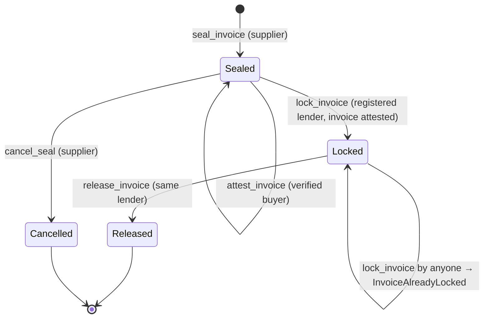
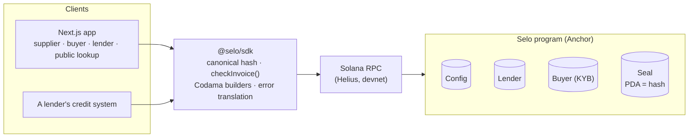

<p align="center"></p>

<p align="center"><b>One invoice. One lender. Ever.</b></p>

<p align="center">
  A public, neutral invoice registry on Solana that stops the same invoice from being financed twice.
</p>

<p align="center">
  <a href="https://www.youtube.com/watch?v=FW5T28l-9iA"></a>
  <a href="https://www.youtube.com/watch?v=keZ3Au-Aty0"></a>
  <a href="https://selo-iota-three.vercel.app"></a>
  <a href="https://explorer.solana.com/address/4zmhCsPLVfk7UEnEgpNfUTCcoXFX2tPbjyJtVit7Mhio?cluster=devnet"></a>
  
  
  <a href="LICENSE"></a>
</p>

---

Receivables are financed by lenders who cannot see each other. The same invoice can be pledged to
two lenders, or an invented one financed several times. In the First Brands collapse, prosecutors
allege fake invoices and collateral pledged two or three times, with billions lost by creditors.

**Selo gives every invoice a single on-chain address derived from its data.** A lender checks the
address before financing. Once one lender locks the invoice, every other lender is rejected and told
who financed it first. Retyping the invoice in lowercase or with extra spaces does not create a new
one. Only a hash goes on-chain.

> **Devnet only.** Test tokens only, no real money, no yield. Built for the Colosseum Crypto
> World's Fair (Solana track).

| | |
|---|---|
| Pitch video | [youtube.com/watch?v=FW5T28l-9iA](https://www.youtube.com/watch?v=FW5T28l-9iA) |
| Demo video (the five moments) | [youtube.com/watch?v=keZ3Au-Aty0](https://www.youtube.com/watch?v=keZ3Au-Aty0) |
| Live app | [selo-iota-three.vercel.app](https://selo-iota-three.vercel.app) |
| Program ID (devnet) | [`4zmhCsPLVfk7UEnEgpNfUTCcoXFX2tPbjyJtVit7Mhio`](https://explorer.solana.com/address/4zmhCsPLVfk7UEnEgpNfUTCcoXFX2tPbjyJtVit7Mhio?cluster=devnet) |
| Fee mint, `USDC-dev` (test token) | [`Gj8cs9urnjgy29Nz3k5EQNrJZLbapCDSi55X4SU4xAqv`](https://explorer.solana.com/address/Gj8cs9urnjgy29Nz3k5EQNrJZLbapCDSi55X4SU4xAqv?cluster=devnet) |
| Lock fee | 1 `USDC-dev` per locked invoice |
| Lender SDK | [`packages/sdk`](packages/sdk): `checkInvoice()`, canonical hash, instruction builders |

---

## For judges: Selo in five minutes

1. **See a rejection without a wallet (1 min).** Open
   [`/verificar`](https://selo-iota-three.vercel.app/verificar), choose **Invoice hash** and paste:

   ```
   987403bcf71b7cb4655aeb1bd500703888890f56eea9cf36411e9b9786c0c90c
   ```

   The registry answers *Financed by Lender A* with the lock date, read live from devnet. Any
   other lender that tries to lock this invoice is rejected by the program. The *seal account ↗*
   link opens the account in Solana Explorer.
2. **Read the one call a lender integrates (1 min):** [`checkInvoice()`](#integrating-checkinvoice).
3. **Check the rules the program enforces (2 min):** [Invariants](#invariants) and the
   [trust model](#trust-model-verified-buyers), each covered by tests ([Testing](#testing)).
4. **Run the five demo moments yourself (optional):** the [demo guide](docs/demo.md) seals,
   attests, locks and gets rejected twice, on devnet in the browser. `pnpm e2e-demo` runs the same
   flow from the command line.

| What a judge may look for | Where |
|---|---|
| Videos | [Pitch](https://www.youtube.com/watch?v=FW5T28l-9iA), [demo of the five moments](https://www.youtube.com/watch?v=keZ3Au-Aty0) |
| Working product | [Live app](https://selo-iota-three.vercel.app), [program on devnet](https://explorer.solana.com/address/4zmhCsPLVfk7UEnEgpNfUTCcoXFX2tPbjyJtVit7Mhio?cluster=devnet), [demo guide](docs/demo.md) |
| Why Solana | [What Selo is](#what-selo-is-and-is-not), [architecture](docs/ARCHITECTURE.md#why-solana) |
| Technical depth | [Architecture](docs/ARCHITECTURE.md), [program reference](#program-reference), [122 tests](#testing) |
| Security thinking | [Security and threat model](SECURITY.md), [limitations](#limitations) |
| Business model | [Business model](#business-model), [pitch script](docs/pitch.md) |
| Open source | MIT license; the whole stack is in this repository |

---

## Contents

- [What Selo is, and is not](#what-selo-is-and-is-not)
- [How it works](#how-it-works)
- [Integrating: `checkInvoice()`](#integrating-checkinvoice)
- [Trust model: verified buyers](#trust-model-verified-buyers)
- [Invariants](#invariants)
- [Canonical invoice hash](#canonical-invoice-hash)
- [Architecture](#architecture)
- [Program reference](#program-reference)
- [Testing](#testing)
- [Repository layout](#repository-layout)
- [Running it](#running-it)
- [Limitations](#limitations)
- [Business model](#business-model)
- [Roadmap](#roadmap)
- [Documentation](#documentation)
- [Team](#team)

---

## What Selo is, and is not

- **Is:** a shared registry of invoices, readable by anyone, that enforces "one invoice, one
  lender" on-chain.
- **Is not:** a lender. Selo has no pool, no loans and no token. Factoring companies, fintech
  lenders and on-chain credit protocols are its **customers, not competitors**: they keep their own
  underwriting and money flows and call Selo before they fund.
- **Why Solana:** a check is a free account read, and a lock costs a fraction of a cent and
  confirms in under a second. That makes it practical to register small invoices and to check in
  real time inside a credit decision. A neutral, public ledger also means no lender has to trust a
  registry run by a competitor.

## How it works

Four roles, five steps:

1. **The supplier seals the invoice.** The browser computes a canonical hash of the invoice data;
   only the hash and three clear-text terms (amount, currency, due date) go on-chain. The `Seal`
   account lives at a PDA derived from the hash, so **sealing the same invoice again fails**, even
   if it is typed differently.
2. **The buyer attests it.** The company that owes the money confirms the invoice is real and due.
   Only a buyer whose identity the registry has verified can attest ([below](#trust-model-verified-buyers)).
3. **Lender A checks and locks it.** `checkInvoice()` says the invoice is free and attested by its
   verified buyer. Lender A locks it and pays the lock fee.
4. **Lender B is rejected.** Any later lock fails, and the SDK turns the failure into
   *"Already financed by Lender A on 08 Oct 2026."*
5. **When the invoice is paid,** the lender that locked it releases it. The record stays forever.



Attestation is a flag independent of the status: a buyer can attest while the invoice is `Sealed`
or `Locked`. No other transition exists.

## Integrating: `checkInvoice()`

The call a lender puts in its credit flow, from [`packages/sdk`](packages/sdk):

```ts
import { createSolanaRpc } from "@solana/kit";
import { checkInvoice } from "@selo/sdk";

const rpc = createSolanaRpc("https://devnet.helius-rpc.com/?api-key=<KEY>");

const check = await checkInvoice(rpc, {
  buyerTaxId: "US 94-1081436", // any formatting: it is canonicalized
  supplierTaxId: "DE 811 907 980",
  number: "INV-2026-0042",
  amount: 1_250_000n, // minor units (cents)
  currency: "USD",
  dueDate: "2027-01-15",
});

switch (check.status) {
  case "free":      /* never registered: ask the supplier to seal it first */ break;
  case "sealed":    /* registered, not financed */                            break;
  case "locked":    /* financed by check.lender.name on check.lockedAt */     break;
  case "released":  /* paid and closed */                                     break;
  case "cancelled": /* withdrawn by the supplier */                           break;
}

const safeToFinance =
  check.status === "sealed" &&
  check.attested &&
  check.buyer?.verification === "verified";
```

`checkInvoice()` also accepts the 32-byte hash or its hex string, for public lookups without the
invoice data (buyer verification is then reported as `"unknown"`).

The SDK also provides:

| Export | Purpose |
|---|---|
| `canonicalize()`, `invoiceHash()`, `sealArgs()` | Canonical string, hash and `seal_invoice` arguments from invoice data |
| `partyIdHash()`, `findBuyerRecordByTaxId()` | The verified-buyer account for a tax ID |
| `listSeals()`, `listBuyerRecords()` | Seals by supplier or buyer; a wallet's verified identities |
| `explainError()`, `describeSeloError()` | Readable messages for every program error, including *who* financed a locked invoice |
| `get*Instruction()` | Instruction builders generated from the IDL (Codama, `@solana/kit`) |

## Trust model: verified buyers

The registry stops double financing only if attestations mean something. Without identity, a
dishonest supplier could name a wallet it controls as "the buyer" and attest its own invented
invoice. Selo closes that gap with a **registry of verified buyers (KYB)**:

- A `Buyer` account lives at `["buyer", sha256("v1|party|" + canonical tax ID)]` and holds the one
  wallet allowed to sign for that company. Because the address is derived from the tax ID, **a
  company can have only one verified wallet**, and anyone who holds the invoice can derive it.
- The registry admin acts as the verifier: it registers a wallet only after checking off-chain that
  it belongs to the holder of that tax ID, and can revoke it (`set_buyer_active`).
- `attest_invoice` requires the signer's active `Buyer` record.
- `lock_invoice` takes the `Buyer` account **derived from the buyer tax ID in the invoice the lender
  holds** and fails unless that company's wallet is the one that attested (`BuyerMismatch`) and it
  is still verified (`BuyerNotVerified`).

| Attack | Result |
|---|---|
| Supplier names its own wallet as the buyer | Cannot attest: `BuyerNotVerified` |
| Supplier gets a *different* verified company to attest | Lock fails: `BuyerMismatch`; `checkInvoice()` reports `"mismatch"` |
| Fraudster registers as an existing company with a new wallet | Impossible: one `Buyer` per tax ID |
| Buyer's key is compromised | Admin revokes it; new attestations and locks against it fail |

**Why KYB and not a multisig?** A multisig protects custody of a key; it says nothing about *whose*
key it is, since a fraudster can create a multisig as easily as a wallet. Identity is the missing
link, so the registry binds a verified identity to a wallet. Multisig still fits on top: the
`authority` of a `Buyer` can be a Squads vault, so a company's attestations require several of its
officers to sign, with no program change.

**On devnet** the admin key plays the verifier. In production, verification would come from
accredited KYB providers (for example as credentials on the Solana Attestation Service), with the
admin key itself held by a multisig.

## Invariants

These hold for every reachable state and are covered by the test suite:

1. **One seal per invoice.** A `Seal` exists at most once per canonical hash; a second
   `seal_invoice` fails with `InvoiceAlreadySealed`.
2. **Seals are never closed.** A `Released` or `Cancelled` seal keeps its account forever. Closing it
   to reclaim rent would delete the PDA and let the same invoice be sealed and financed again, so
   there is no close instruction, and none must ever be added.
3. **One lender per invoice.** Only a `Sealed` invoice can be locked; a `Locked` or `Released` one
   cannot be locked by anyone, including the lender that holds it.
4. **No lock without a verified, matching attestation.** A lock requires `buyer_attested`, and the
   attesting wallet must be the active verified wallet of the company on the invoice.
5. **Only the lock holder releases.** `release_invoice` checks `Seal.lender == signer`.
6. **Exact fees.** Each lock moves exactly `Config.lock_fee` of `Config.fee_mint` to
   `Config.treasury`; a failed lock moves nothing.
7. **One wallet per verified company.** The `Buyer` PDA is keyed by the tax ID hash.
8. **The admin is the deployer.** `initialize` only accepts the program's upgrade authority, so
   nobody can front-run the deployment and take over the registry.

## Canonical invoice hash

Two parties typing the same invoice must reach the same hash, so normalization is specified,
versioned and tested ([`packages/sdk/src/hash.ts`](packages/sdk/src/hash.ts)):

```
v1|<buyer tax ID>|<supplier tax ID>|<invoice number>|<amount>|<currency>|<due date>

tax IDs         letters and digits only, uppercase       "us 94-1081436" → US941081436
invoice number  trimmed, uppercase, inner spaces removed "  inv - 0042 " → INV-0042
amount          integer in minor units, no leading zeros
currency        ISO 4217, uppercase
due date        YYYY-MM-DD

invoice_hash = sha256(utf8(canonical string))
```

- The `v1|` prefix lets the format evolve without colliding with existing seals.
- The hash is **deliberately unsalted**: a per-user salt would stop two lenders from detecting the
  same invoice, which is the whole point.
- Golden vectors are pinned in [`packages/sdk/test/hash.test.ts`](packages/sdk/test/hash.test.ts):
  changing them would orphan every seal on-chain.
- On-chain, only `face_amount`, `currency` and `due_ts` are stored in clear. No names, descriptions
  or documents.

## Architecture



- **The PDA is the uniqueness check.** `seal_invoice` creates the account at `["seal", hash]`
  with `init`, so a duplicate fails in the runtime itself, with no index or lookup table to keep
  consistent.
- **Hashing happens in the browser.** Invoice data never leaves the user's machine; the app and the
  SDK share the same `canonicalize()`.
- **Every transaction is simulated first.** A rejection (duplicate seal, invoice already financed)
  is shown in plain language before the wallet asks for a signature, so no fee is spent on a
  transaction that would fail.
- **Wallet Standard + `@solana/kit`** end to end: wallet signers go straight into the generated
  instruction builders, with no web3.js v1 dependency.

Design decisions, data flows and account sizes: [docs/ARCHITECTURE.md](docs/ARCHITECTURE.md).

## Program reference

Anchor program in [`programs/selo`](programs/selo). Every PDA stores its bump; amounts are `u64` in
minor units with checked arithmetic.

### Accounts

| Account | Seeds | Fields |
|---|---|---|
| `Config` | `["config"]` | `admin`, `treasury`, `fee_mint`, `lock_fee`, `paused` |
| `Lender` | `["lender", wallet]` | `authority`, `name`, `active`, `locks_count` |
| `Buyer` | `["buyer", tax_id_hash]` | `authority`, `tax_id_hash`, `name`, `active`, `verified_at` |
| `Seal` | `["seal", invoice_hash]` | `invoice_hash`, `supplier`, `buyer`, `face_amount`, `currency`, `due_ts`, `status`, `buyer_attested`, `lender`, `locked_at`, `created_at` |

### Instructions

| Instruction | Signer | Checks |
|---|---|---|
| `initialize(lock_fee)` | upgrade authority | fee ≤ 100 `USDC-dev`; fee mint has 6 decimals |
| `register_lender(name)`, `set_lender_active` | admin | name 1–32 bytes |
| `register_buyer(tax_id_hash, name)`, `set_buyer_active` | admin (KYB verifier) | name 1–32 bytes; one per tax ID |
| `set_paused` | admin | blocks sealing and locking |
| `seal_invoice(hash, buyer, face, currency, due_ts)` | supplier | not paused; new PDA; `face > 0`; due date in the future; ISO currency; buyer ≠ supplier |
| `attest_invoice` | buyer | `Seal.buyer == signer`; signer's `Buyer` active; `Sealed` or `Locked`; not yet attested |
| `lock_invoice` | lender | not paused; lender active; `Sealed`; attested; invoice's `Buyer` matches and is active; charges the fee |
| `release_invoice` | locking lender | `Locked`; `Seal.lender == signer` |
| `cancel_seal` | supplier | `Sealed` only; the account is kept |

Events: `InvoiceSealed`, `InvoiceAttested`, `InvoiceLocked`, `InvoiceReleased`, `InvoiceCancelled`,
`BuyerVerified`. A rejected attempt emits nothing, because the whole transaction fails; when a lock
is rejected because the invoice is taken, the program logs who holds it and the SDK reads the
lender's name from its account.

### Errors

Every custom error has a readable message in the SDK ([`errors.ts`](packages/sdk/src/errors.ts)),
and no raw Anchor error reaches the UI.

| Error | When |
|---|---|
| `InvoiceAlreadySealed` | the same invoice (same canonical hash) is sealed again |
| `InvoiceAlreadyLocked` | a lender locks an invoice another lender already financed |
| `NotAttested` | a lock before the buyer attested |
| `BuyerNotVerified`, `BuyerMismatch` | the attesting wallet is not, or is no longer, the verified wallet of the company on the invoice |
| `LenderInactive`, `NotLockHolder`, `InvalidStatus` | wrong lender, wrong signer or wrong state |
| `Paused`, `DueDateInPast`, `InvalidAmount`, `InvalidCurrency`, `InvalidBuyer` | input and circuit-breaker checks |
| `NotUpgradeAuthority`, `LockFeeTooHigh`, `InvalidFeeMint` | registry setup |

## Testing

**122 tests, all passing**, run with Vitest against the compiled program in
[LiteSVM](https://github.com/LiteSVM/litesvm), so the whole suite takes about three seconds.

| File | Tests | Covers |
|---|---:|---|
| [`tests/seal.test.ts`](tests/seal.test.ts) | 18 | duplicate seals with identical data, retyped data, another wallet, after cancellation; PDA pre-funding griefing; pause; cancellation keeps the account |
| [`tests/lock.test.ts`](tests/lock.test.ts) | 26 | attestation by the right signer only; lock charges the exact fee; Lender B rejected with a translatable error; no lock without attestation; inactive, unregistered or impersonating lenders; wrong treasury, mint or payer; release by the lock holder only |
| [`tests/buyer.test.ts`](tests/buyer.test.ts) | 13 | KYB registry: one wallet per tax ID; unverified and revoked buyers; `BuyerMismatch`; buyer verification in `checkInvoice()` |
| [`tests/admin.test.ts`](tests/admin.test.ts) | 17 | `initialize` only by the upgrade authority; fee and mint limits; admin-only lender registry and pause |
| [`tests/demo.test.ts`](tests/demo.test.ts) | 1 | the five demo moments, end to end |
| [`tests/program.test.ts`](tests/program.test.ts) | 2 | program loads; fee mint setup |
| [`packages/sdk/test/hash.test.ts`](packages/sdk/test/hash.test.ts) | 39 | canonical form and pinned golden hash vectors |
| [`packages/sdk/test/errors.test.ts`](packages/sdk/test/errors.test.ts) | 6 | program errors translated to readable messages |

```bash
pnpm test:program   # anchor build → Codama client → Vitest on LiteSVM
```

CI ([`.github/workflows/ci.yml`](.github/workflows/ci.yml)) runs the following:
- prettier, rustfmt and `clippy -D warnings`;
- the program build;
- a check that the generated client matches the IDL;
- the typecheck, the tests and the app build.

`pnpm e2e-demo 3` runs the five moments three times against a live cluster through the app's own
transaction code.

## Repository layout

```
programs/selo/   Anchor program (Rust)
packages/sdk/    canonical hash, checkInvoice(), buyers, error translation, Codama client
app/             Next.js frontend: landing page, /fornecedor, /comprador, /financiador, /verificar
scripts/         USDC-dev mint, registry seeding, end-to-end demo against a cluster
tests/           program tests (Vitest + LiteSVM)
docs/            architecture, demo guide, pitch script
```

| Route | Who | What |
|---|---|---|
| `/` | everyone | Landing page: the problem, how it works, the hash, the SDK |
| `/fornecedor` | supplier | Enter the invoice, hash it in the browser, seal it; list your seals |
| `/comprador` | buyer | See your verified identity and the invoices addressed to you; attest |
| `/financiador` | lender | Look an invoice up, see status and buyer verification, lock it |
| `/verificar` | anyone | Public lookup by invoice data or hash, no wallet needed |

The route names are Portuguese (*fornecedor* = supplier, *comprador* = buyer, *financiador* =
lender, *verificar* = verify); the whole interface is in English.

### Stack

| Layer | Choice |
|---|---|
| Program | Rust 1.89, Anchor 1.2.0, Solana CLI 4.1.2 |
| Tests | Vitest 5 + LiteSVM 1.4.1 |
| Client | `@solana/kit` 8.3.0, client generated from the IDL with Codama |
| Frontend | Next.js 16 (App Router), React 19, Tailwind CSS 4, Wallet Standard + `@solana/react` |
| Infrastructure | Helius devnet RPC, Vercel |

## Running it

### Prerequisites

The program builds on Linux (on Windows, use WSL). Versions are pinned in `rust-toolchain.toml`
and `Anchor.toml`.

```bash
# System deps (Ubuntu / WSL)
sudo apt-get install -y build-essential pkg-config libudev-dev libssl-dev

# Rust, Solana CLI 4.1.2, Anchor CLI 1.2.0
curl --proto '=https' --tlsv1.2 -sSf https://sh.rustup.rs | sh -s -- -y
sh -c "$(curl -sSfL https://release.anza.xyz/v4.1.2/install)"
curl -sSfL -o ~/.local/bin/anchor \
  https://github.com/otter-sec/anchor/releases/download/v1.2.0/anchor-1.2.0-x86_64-unknown-linux-gnu
chmod +x ~/.local/bin/anchor

# Node 24 + pnpm (corepack)
corepack enable && pnpm install
```

### Build and test

```bash
pnpm test:program   # anchor build → Codama client → Vitest on LiteSVM (122 tests)
pnpm lint           # prettier, rustfmt, clippy -D warnings, eslint
pnpm typecheck
```

### Run the app against devnet

The app reads everything it needs (program ID, fee mint, treasury) from the SDK and the on-chain
`Config` account, so pointing it at devnet only takes an RPC URL:

```bash
cp .env.example app/.env.local       # set NEXT_PUBLIC_RPC_URL to a Helius devnet URL
pnpm --filter app dev                # http://localhost:3000
```

### Run the full demo on your own registry

```bash
cp .env.example .env                 # RPC_URL (a Helius devnet URL) and WALLET_PATH (upgrade authority)

# Idempotent: mint, initialize, register lenders, verify the buyer, fund wallets
LENDER_A=<wallet> LENDER_B=<wallet> SUPPLIER=<wallet> BUYER=<wallet> pnpm seed-demo

pnpm e2e-demo 3                      # the five demo moments, 3 times, through the app's own tx code
```

Step-by-step recording script, wallets and known issues: [`docs/demo.md`](docs/demo.md).

## Limitations

- **The hash is not strong secrecy.** Tax IDs have little entropy; someone who already knows both
  parties can guess the hash of their invoices. It hides invoice data from casual readers, not from
  insiders.
- **Selo only sees lenders who check it.** Double financing is detected among lenders that consult
  the registry, which is why its value grows with every lender that joins.
- **Exact data still matters.** Normalization absorbs case, spacing and punctuation, not every
  variation: `INV-0001` and `INV-1` are different numbers. A future `v2` format can tighten this
  without breaking `v1` seals.
- **Collusion between supplier and real buyer** is out of scope: if the verified buyer attests an
  invoice it knows is fake, the registry records a genuine attestation.
- **A seal is not an assignment.** Selo records that a lender locked an invoice; the legal
  assignment of the receivable is still the lenders' contract.
- **Verification is centralized on devnet.** One admin key verifies buyers; see the roadmap.
- **Not audited.** This is a hackathon build on devnet. See [SECURITY.md](SECURITY.md).

## Business model

- **Revenue:** a fee per locked invoice, paid by the lender. On devnet, a flat 1 `USDC-dev`.
- **Pricing assumption** (not market data): 5 basis points of face value per lock.
- **Market size reference:** global factoring volume was about €4.04 trillion in 2025 (FCI). If 1%
  of that volume went through Selo at 5 bps, that is about €20 million a year.
- **Why lenders pay:** the fee is smaller than a single loss to double financing, and the registry
  becomes more valuable with every lender that joins.
- **Who the customers are:** factoring companies, fintech lenders, banks' receivables desks and
  on-chain credit protocols. Selo serves them all from the same neutral registry and competes with
  none of them.

## Roadmap

- **Pilots** with factoring firms and on-chain credit protocols.
- **Verification network:** accept KYB credentials from several accredited providers (Solana
  Attestation Service) instead of a single admin; admin and upgrade keys in a Squads multisig.
- **HTTP API and webhooks** so traditional lenders can check and subscribe without a wallet.
- **Partial financing:** several lenders funding tranches of one invoice, capped at its face value.
- **Hash format v2:** tighter normalization of invoice numbers.
- **Audit**, legal review of receivables assignment across jurisdictions, then mainnet.

## Documentation

| Document | What it covers |
|---|---|
| [docs/ARCHITECTURE.md](docs/ARCHITECTURE.md) | Components, transaction flows, design decisions, account sizes |
| [SECURITY.md](SECURITY.md) | Threat model, the attacks the program blocks, known limitations, reporting |
| [docs/demo.md](docs/demo.md) | How to run and record the five demo moments on devnet; troubleshooting |
| [docs/pitch.md](docs/pitch.md) | The pitch video script and the numbers behind it |
| [CLAUDE.md](CLAUDE.md), [TASKS.md](TASKS.md), [docs/prompts.md](docs/prompts.md) | The project brief, day-by-day plan and prompts used to build Selo with Claude Code |

## Team

Built by **Davi Marques Oliveira** ([@davimqz](https://github.com/davimqz)) for the Colosseum
Crypto World's Fair, Solana track. Development was AI-assisted with Claude Code; the brief, the
plan and the prompts are in the repository.

## License

[MIT](LICENSE)
