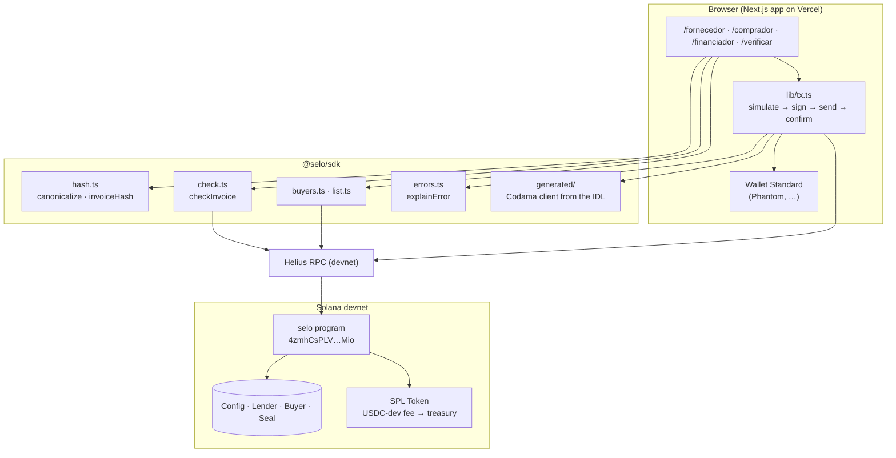
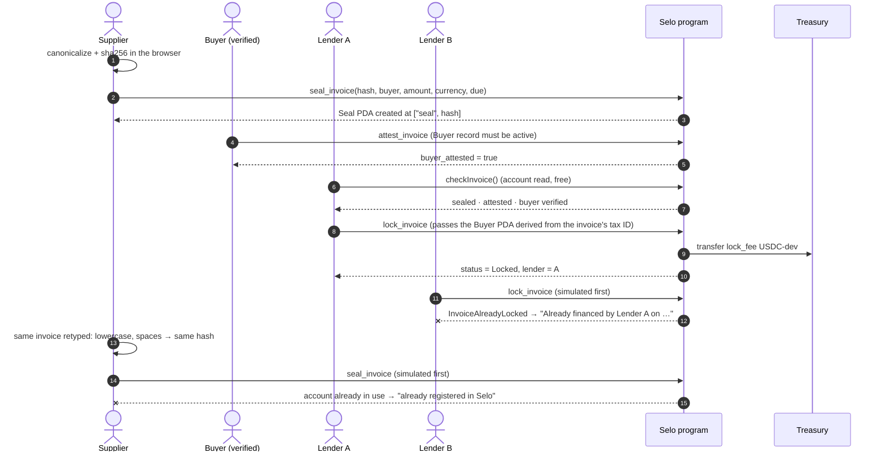
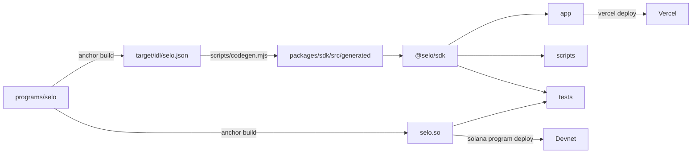

# Architecture

Selo has three moving parts:
- an Anchor program that holds the registry;
- a TypeScript SDK that every client uses to hash, read and write it;
- a Next.js app that puts a face on the five demo moments.

This document explains how they fit together and why they are built this way. The account and
instruction tables are in the [README](../README.md#program-reference).

## Components

| Part | Path | Responsibility |
|---|---|---|
| Program | [`programs/selo`](../programs/selo) | Owns all state. Enforces uniqueness, the state machine, KYB checks and the fee. |
| SDK | [`packages/sdk`](../packages/sdk) | The canonical hash (the only definition of "the same invoice"), `checkInvoice()`, PDA derivation, account listing, error translation and the generated instruction builders. |
| App | [`app`](../app) | Four role screens and the landing page. Hashes invoices in the browser; never sees private keys. |
| Scripts | [`scripts`](../scripts) | Create the `USDC-dev` mint; seed a registry idempotently; run the five moments end to end against a cluster. |
| Tests | [`tests`](../tests) | 122 Vitest tests, 77 of them against the compiled program in LiteSVM. |

## The five moments, as transactions

Moments 4 and 5 never reach the wallet. The app simulates every transaction against the program
first ([`app/src/lib/tx.ts`](../app/src/lib/tx.ts)). A rejection becomes a readable message
before the user is asked to sign, so no fee is spent on a transaction that would fail.

## Design decisions

### The PDA is the uniqueness check

`seal_invoice` creates the `Seal` with Anchor's `init` at `["seal", invoice_hash]`. If that address
already holds an account, the runtime rejects the instruction. There is no index, mapping or
off-chain database whose consistency could drift: the address space of the program *is* the
registry, and "already sealed" is a property of Solana itself.

Two consequences follow:

- **Seals are never closed.** Closing a `Released` or `Cancelled` seal to reclaim rent would free
  the address and let the same invoice be sealed and financed again. The program has no close
  instruction, and the invariant is documented in the code and the README.
- **Pre-funding the address cannot block a seal.** Anyone can send lamports to a PDA before it
  exists. The test suite covers that sealing still works when someone has done so (`tests/seal.test.ts`).

### One definition of "the same invoice"

The canonical form (`v1|buyer|supplier|number|amount|currency|due`) lives in exactly one place,
[`packages/sdk/src/hash.ts`](../packages/sdk/src/hash.ts), and the app, the scripts and the tests
import it. It absorbs the variations people actually type: case, spaces, punctuation in tax IDs,
padding around invoice numbers. Golden vectors pin the output, because changing the
normalization would silently orphan every seal already on-chain. The `v1|` prefix leaves room for
a stricter `v2` without collisions.

The hash is unsalted on purpose. A salt per user would make the same invoice produce different
hashes for different lenders, and double financing would go undetected.

### Minimal data on-chain

A seal stores the hash, the parties' wallets and three terms a lender needs to decide: face
amount, currency and due date. No names, invoice numbers, descriptions or documents. The program
never sees the raw invoice; only the hash crosses the wire.

### Buyer identity is bound to the invoice, not to the signer

An attestation is only meaningful if the attesting wallet belongs to the company named on the
invoice. The `Buyer` PDA is keyed by `sha256("v1|party|" + canonical tax ID)`, so:

- a company can have exactly one verified wallet (one account per tax ID);
- a lender holding the invoice can derive the company's `Buyer` account from the buyer tax ID it
  sees, and `lock_invoice` requires that account. The lock fails unless that company's wallet is
  the one that attested (`BuyerMismatch`) and it is still verified (`BuyerNotVerified`).

The supplier cannot pick the account to check against, because the lender derives it from the
document it underwrote.

### Fee in an SPL token, checked to the unit

`lock_invoice` transfers `Config.lock_fee` of `Config.fee_mint` from the lender's token account to
`Config.treasury` with a `transfer_checked` CPI to the token program. The program checks:
- the treasury and the mint are the configured ones (`has_one`);
- the source account holds that mint and is owned by the signing lender;
- the decimals match, checked again inside the transfer.

At `initialize`, the mint must have 6 decimals and the fee is capped at `MAX_LOCK_FEE` (100
`USDC-dev`).

A failed lock moves nothing, because the whole transaction reverts.

### The deployer is the admin

`initialize` accepts only the program's upgrade authority, read from the program data account. In
the gap between deploy and initialize, nobody can front-run the deployment and install
themselves as admin.

### Readable errors, everywhere

Every custom error maps to a sentence in [`errors.ts`](../packages/sdk/src/errors.ts). For
`InvoiceAlreadyLocked`, the SDK reads the seal and the lender account to answer *who* financed it
and *when*. Both the app and `e2e-demo` use the same `explainError()`, and no raw Anchor error
reaches the UI.

### `@solana/kit` end to end

The client is generated from the Anchor IDL with Codama, on `@solana/kit` 8. Wallet Standard
signers from `@solana/react` go straight into the generated builders. The classic Wallet
Adapter would have pulled in web3.js v1 and a second transaction model. CI fails if the generated
client drifts from the IDL.

## Why Solana

- **A check is a free account read.** `checkInvoice()` reads the seal, the lender and the buyer
  record at addresses derived from the invoice: no indexer, no subgraph, no API key beyond an RPC.
- **Writes are cheap and fast.** Sealing and locking cost a fraction of a cent in fees and confirm
  in about a second. That is what makes it practical to register small invoices and check inside
  a live credit decision.
- **Accounts as a key-value registry.** PDAs give a global, collision-free namespace keyed by the
  invoice hash, with uniqueness enforced by the runtime.
- **Neutrality.** No lender has to trust a database run by a competitor. The registry is public,
  and its rules are a program anyone can read.

## Account sizes and costs

Sizes include the 8-byte Anchor discriminator. Rent is the one-time, rent-exempt deposit at the
current rate.

| Account | Bytes | Rent-exempt deposit | Paid by |
|---|---:|---:|---|
| `Seal` | 174 | ≈ 0.0021 SOL | supplier, once per invoice (never reclaimed, by design) |
| `Buyer` | 118 | ≈ 0.0017 SOL | admin, once per verified company |
| `Lender` | 86 | ≈ 0.0015 SOL | admin, once per lender |
| `Config` | 114 | ≈ 0.0017 SOL | admin, once |

On devnet the lock fee is a flat 1 `USDC-dev`. The pricing assumption for production is 5 basis
points of face value ([business model](../README.md#business-model)).

## Build and release pipeline

CI ([`.github/workflows/ci.yml`](../.github/workflows/ci.yml)) runs the following on every pull
request:
- prettier, rustfmt and `clippy -D warnings`;
- `anchor build`;
- a regenerate-and-diff check on the client;
- the typecheck, the full test suite and the app build.
